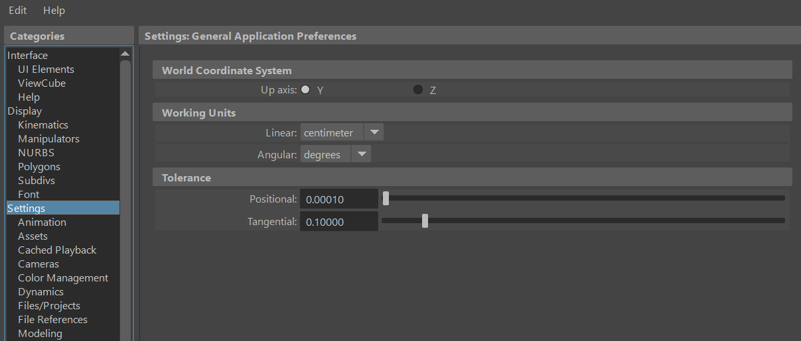
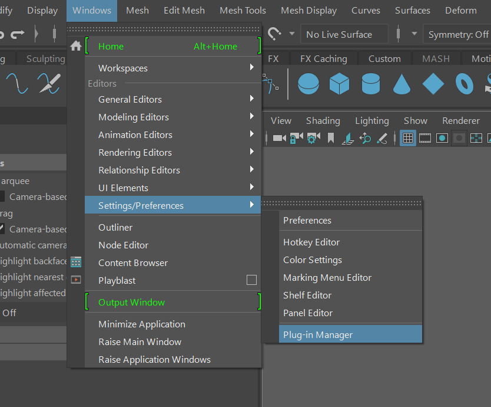
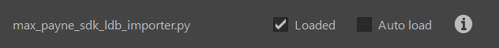
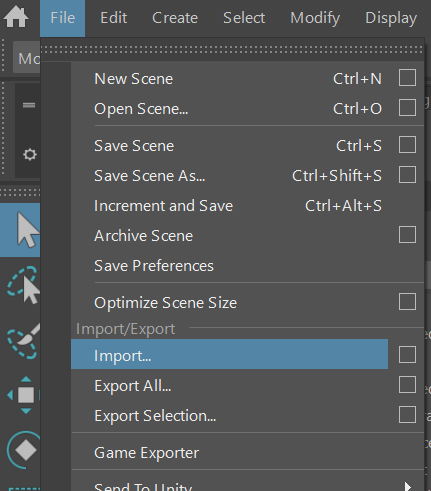
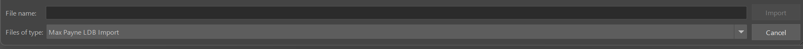

# Max Payne 1 LDB Importer plugin for Maya 2022


# Prerequisites:

You will need:
- Maya 2022 with Python 3 support

# Maya Configuration:

- Go to Maya's menu ```Windows > Settigns/Preferences > Preferences```
- Set ```Up axis``` to ```Y```
- Set ```Working Units``` to ```centimeter```


# Installation:

No additional Python packages are required. PCX and SCX textures are decoded
by the bundled SDK and written as TGA images for Maya.

Put both ```max_payne_sdk_ldb_importer.py``` and ```max_payne_sdk_kf2_importer.py``` files into the ```plug-ins``` directory:

Windows:

```
C:\Users\<username>\Documents\maya\<version>\plug-ins\
```

Mac OSX:

```
/Users/Shared/Autodesk/maya/<version>/plug-ins/
```

Linux:

```
/home/<username>/maya/<version>/plug-ins/
```

Put the ```max_payne_sdk``` and the ```max_payne_maya``` into the ```scripts``` directory:

Windows:

```
C:\Users\<username>\Documents\maya\<version>\scripts\
```

Mac OSX:

```
/Users/Shared/Autodesk/maya/<version>/scripts/
```

Linux:

```
/home/<username>/maya/<version>/scripts/
```

Start Maya and enable the plugin:




# Import:

- Go to Maya's menu ```File > Import...```
- Select ```Max Payne LDB Import```



